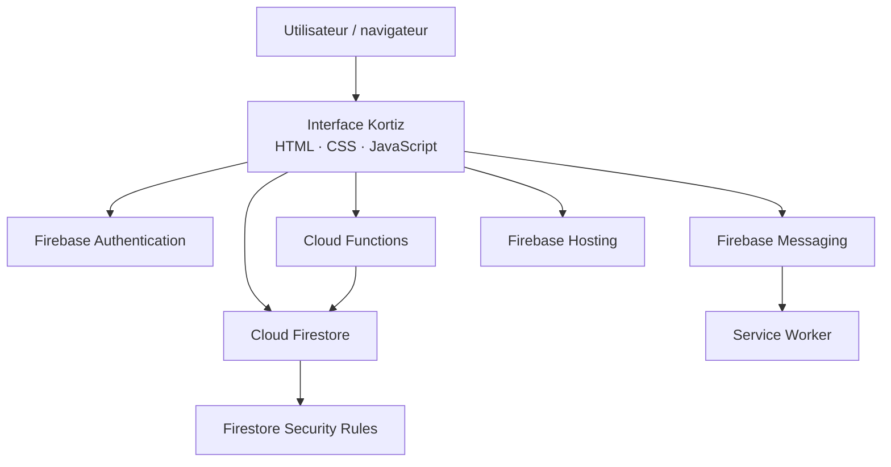

<div align="center">


# Kortiz

### Les dépenses partagées, simplement.

**Organiser les dépenses d'un groupe, anticiper les frais et suivre les remboursements — sans faire transiter d'argent dans l'application.**

*Shared expenses. Clear balances. Better coordination.*


[](https://github.com/carlxwj/kortiz/actions/workflows/checks.yml)


**Application web collaborative · Responsive · Progressive Web App (manifest)**

</div>

---

**Liens utiles :** [Site public Kortiz](https://kortiz-de19f.web.app/) · [Code et tests automatisés](https://github.com/carlxwj/kortiz/actions/workflows/checks.yml)

> Le site public peut correspondre à une version différente du code de ce dépôt. Les parcours qui nécessitent Firebase doivent être validés dans l'environnement concerné.

## Présentation

**Kortiz** est un projet personnel d'application web conçu pour simplifier l'organisation financière du quotidien : colocation, voyage, couple, sortie entre amis ou dépenses partagées dans un groupe.

L'idée est de centraliser, dans une même interface, les **dépenses réelles**, les **prévisions**, les **soldes entre participants** et les **échanges du groupe**. Chaque personne peut mieux comprendre qui a payé, qui doit quoi et quelles dépenses restent à anticiper.

> [!IMPORTANT]
> **Kortiz n'est ni une banque, ni un portefeuille électronique, ni un service de paiement.** L'application ne reçoit, ne détient et ne transfère pas d'argent. Elle permet uniquement d'enregistrer des dépenses, de suivre des demandes de remboursement et de confirmer des règlements effectués **en dehors** de l'application.

**English overview:** Kortiz is a multilingual web application for tracking shared expenses, calculating group balances, planning budgets, coordinating discussions and recording off-platform reimbursements. It does **not** process or transfer funds.

## Fonctionnalités

| Domaine | Fonctionnalités présentes dans le code |
|---|---|
| **Dépenses partagées** | Création de groupes, ajout de dépenses, participants, répartition des montants, historiques et calcul des soldes. |
| **Remboursements** | Demandes, états et confirmations déclaratives de remboursement, sans transaction dans l'application. |
| **Budgets et prévisions** | Budgets indicatifs de groupe, dépenses prévues, dépenses récurrentes et calendrier partagé. |
| **Communication** | Discussions de groupe, messages privés et sondages intégrés aux conversations. |
| **Vie du groupe** | Invitations, gestion des membres, relations entre amis et rôles selon les droits prévus. |
| **Devises** | Affichage de tableaux de bord dans différentes devises avec logique de conversion et de repli. |
| **Notifications** | Paramètres de notifications et intégration de notifications web lorsque le navigateur et Firebase Messaging sont configurés. |
| **Accessibilité du produit** | Interface responsive, traductions **français, anglais, portugais et espagnol**, manifest web installable. |
| **Pages publiques** | Présentation du service, formulaire de contact, informations légales et paramètres de confidentialité. |

Ces fonctions sont documentées à partir des **sources et tests du dépôt**. La présence d'une fonctionnalité dans le code ne signifie pas que tous ses parcours ont été vérifiés sur un environnement Firebase de production.

### Un parcours type

1. Créer un groupe pour un logement, un voyage ou une activité.
2. Inviter les participants et définir, si besoin, un budget.
3. Enregistrer les dépenses et leurs répartitions.
4. Consulter les soldes et les frais prévus, puis échanger dans la discussion.
5. Effectuer un remboursement **hors Kortiz** et en enregistrer la confirmation.

## Choix techniques

| Couche | Technologies / composants | Rôle |
|---|---|---|
| **Interface** | HTML, CSS, JavaScript (modules navigateur) | Pages, navigation, interactions, responsive design. |
| **Authentification** | Firebase Authentication | Comptes et sessions utilisateurs. |
| **Base de données** | Cloud Firestore | Données applicatives et mises à jour en temps réel. |
| **Backend** | Firebase Cloud Functions, Node.js 22 | Validations et opérations sensibles côté serveur. |
| **Autorisations** | Firestore Security Rules, Storage Rules | Contrôle des accès aux documents et aux fichiers. |
| **Hébergement** | Firebase Hosting | Distribution du frontend et en-têtes HTTP. |
| **Notifications** | Firebase Cloud Messaging, Service Worker | Notifications lorsque le dispositif est activé et autorisé. |
| **Qualité** | `node:test`, GitHub Actions, script d'analyse des secrets | Tests de non-régression et contrôles automatisés. |

> **Précision d'architecture :** cette version utilise principalement du **JavaScript natif côté navigateur** ; elle n'exige pas de compilation React/Vite pour le frontend. Une éventuelle migration vers React/TypeScript constituerait une évolution ultérieure, et non une fonctionnalité déjà livrée ici.

## Architecture générale



Le navigateur assure la navigation et l'affichage. Firestore fournit les données, tandis que les règles d'accès et les Cloud Functions contrôlent les opérations qui nécessitent des garanties supplémentaires. Les calculs de soldes et les changements d'état doivent rester cohérents malgré les interruptions réseau ou les opérations concurrentes.

### Organisation du dépôt

```text
kortiz/
├── .github/
│   ├── workflows/checks.yml      # Tests et contrôle de secrets en CI
│   └── dependabot.yml            # Suivi des dépendances
├── public/
│   ├── index.html                # Point d'entrée principal
│   ├── app.js                    # Interface et interactions applicatives
│   ├── styles.css                # Styles principaux
│   ├── i18n.js                   # Traductions FR / EN / PT / ES
│   ├── currency-logic.js         # Calculs et conversion de devises
│   ├── planning-logic.js         # Prévisions et calendrier
│   ├── notification-logic.js     # Préférences de notifications
│   ├── firebase-messaging-sw.js  # Service Worker de notifications
│   ├── manifest.json             # Métadonnées de l'application web
│   └── ...                       # Pages publiques, assets, autres modules
├── functions/
│   ├── index.js                  # Fonctions Firebase
│   ├── package.json              # Dépendances backend
│   └── .env.example              # Exemple de configuration non secrète
├── tests/                        # Tests métier, sécurité et régressions
├── scripts/scan-secrets.py       # Contrôles locaux de secrets évidents
├── docs/                         # Guides techniques détaillés
├── firestore.rules               # Droits d'accès Firestore
├── storage.rules                 # Droits d'accès Storage
├── firestore.indexes.json       # Index Firestore
├── firebase.json                 # Hosting / Functions / Firestore
├── SECURITY.md                   # Signalement des vulnérabilités
└── README.md                     # Présentation du projet
```

## Démarrer localement

### Prérequis

- **Node.js 22** et npm (version utilisée par les Cloud Functions du dépôt).
- **Python 3** pour le contrôle facultatif des secrets.
- **Firebase CLI** et accès autorisé à un projet Firebase **de développement** pour les essais connectés.
- Un navigateur récent. Certains émulateurs Firebase peuvent nécessiter une installation Java compatible.

### 1. Récupérer le dépôt

```bash
git clone https://github.com/carlxwj/kortiz.git
cd kortiz
```

Le dépôt est privé tant que son propriétaire ne décide pas de le rendre public ; un accès GitHub autorisé peut être nécessaire pour le cloner.

### 2. Exécuter les tests sans connexion au cloud

```bash
node --test tests/*.test.js
```

Contrôler aussi les fichiers avec le scanner local :

```bash
python3 scripts/scan-secrets.py
```

Sous **Windows / PowerShell**, la commande Python peut être :

```powershell
py -3 scripts/scan-secrets.py
```

Ces commandes de test ne nécessitent pas de connexion au projet Firebase de production.

### 3. Installer le backend et la CLI Firebase

```bash
cd functions
npm ci
cd ..
npm install -g firebase-tools
firebase login
```

Le backend possède son propre `package.json` et son propre `package-lock.json`. Le dossier `public/` est servi directement : il n'y a pas de commande `npm run build` frontend dans cette architecture.

### 4. Préparer un environnement de développement

```bash
firebase use --add
firebase use
```

**Sélectionner uniquement un projet de développement autorisé.** Le dépôt n'inclut pas de `.firebaserc` prêt à utiliser ; ce fichier doit rester local.

Le frontend contient des identifiants **publics** de configuration du SDK Firebase. Pour utiliser un projet de développement isolé, il faut également **adapter la configuration du client** et les services concernés : changer la cible CLI ne suffit pas à garantir l'isolation des données.

La configuration d'exemple des fonctions se trouve dans `functions/.env.example`. Les paramètres réellement sensibles doivent être gérés hors du dépôt, notamment dans les secrets Firebase/Google Cloud adaptés.

### 5. Démarrer les émulateurs

```bash
firebase emulators:start --only auth,firestore,functions,hosting
```

Les émulateurs sont utiles pour préparer des tests d'intégration, mais **leur lancement ne garantit pas automatiquement que tous les appels du frontend sont dirigés vers eux**. Vérifier explicitement les connexions émulateurs et utiliser des comptes de test.

> [!CAUTION]
> **Ne pas lancer les scripts `DEPLOYER_*.ps1` ou `CORRIGER_FONCTION_DEPENSES.ps1` sur un projet réel sans examiner leurs cibles et leurs effets.** Ils sont conservés notamment pour l'historique et les tests de régression ; certains peuvent faire référence à d'anciennes versions.

## Tests et qualité

Lors de la préparation de la version GitHub du **30 octobre 2026**, le contrôle suivant a été exécuté :

```bash
node --test tests/*.test.js
```

**Résultat : 257 tests réussis sur 257, aucun échec.**

Les tests couvrent notamment :

- La répartition des dépenses, les arrondis et le calcul des soldes.
- Les états de remboursement et certains scénarios de sécurité financière.
- Les autorisations et régressions liées aux comptes et aux groupes.
- Les invitations, la messagerie et les sondages.
- Les dépenses récurrentes, les budgets, les prévisions et les devises.
- Des vérifications de traductions et de cohérence responsive.

**Limites :** une partie de cette suite repose sur des vérifications unitaires ou statiques. Elle ne remplace **ni un audit de sécurité**, ni des tests end-to-end avec plusieurs comptes réels, ni la validation des règles Firebase en production.

Une GitHub Action lance les tests et le scanner à chaque `push` ou pull request ; elle représente un **contrôle automatique complémentaire**, pas une certification de sécurité.

## Sécurité et confidentialité

Kortiz traite des informations personnelles et des données de dépenses. Leur protection fait partie des objectifs techniques du projet.

**Mesures présentes dans les sources :**

- Authentification Firebase et contrôles de droits selon les ressources.
- Règles Firestore et Storage versionnées.
- Cloud Functions pour des opérations nécessitant des vérifications côté serveur.
- En-têtes HTTP de protection définis dans `firebase.json` (dont CSP et protection contre l'intégration en iframe).
- Tests de non-régression portant notamment sur les accès et les données financières déclaratives.
- Fichiers de configuration locale et clés privées exclus par `.gitignore`.

**À ne jamais publier :** fichiers `.env` réels, `.firebaserc` local, clés de compte de service, tokens, exports Firestore, conversations privées, coordonnées personnelles et journaux contenant des informations sensibles.

Une **clé Web API Firebase destinée au navigateur n'est pas un secret serveur**. La sécurité dépend des règles d'accès, des vérifications backend et de la configuration effective des services. Le scanner de secrets ne suffit pas à certifier qu'un dépôt est exempt de fuite, notamment dans son historique Git.

Le code contient une interface de préférences liée au consentement, mais **les annonces Google restent désactivées** en attendant une solution de consentement certifiée appropriée ; cette interface locale ne constitue pas une CMP certifiée.

En cas de vulnérabilité, suivre [`SECURITY.md`](SECURITY.md) et éviter toute divulgation publique d'informations exploitables.

## Déploiement : précautions indispensables

Les fichiers du dépôt sont **du code source**, pas une preuve que leur version actuelle est installée dans l'environnement de production.

Avant tout déploiement :

1. Sauvegarder et comparer les **règles Firestore/Storage actuellement en production** avec celles du dépôt.
2. Vérifier le projet Firebase actif, les rôles, les secrets et les quotas.
3. Rejouer les tests et le scanner de secrets.
4. Tester les parcours principaux avec **au moins deux comptes distincts** dans un environnement isolé.
5. Valider la compatibilité entre règles, fonctions et frontend avant de publier.

Pour les évolutions concernées par la suppression des comptes, l'ordre de déploiement prévu est **règles Firestore → fonction `deleteAccount` → Hosting**, sous réserve de validation préalable :

```bash
# Exemples : NE PAS exécuter sans validation de l'environnement.
firebase deploy --only firestore:rules
firebase deploy --only functions:deleteAccount
firebase deploy --only hosting
```

Voir la procédure complète dans [`docs/DEPLOIEMENT.md`](docs/DEPLOIEMENT.md).

## Documentation technique

| Guide | Contenu |
|---|---|
| [Architecture et flux](docs/ARCHITECTURE.md) | Composants, responsabilités, invariants métier. |
| [Installation](docs/INSTALLATION.md) | Prérequis et configuration du développement local. |
| [Sécurité et données](docs/SECURITE_DONNEES.md) | Modèle de menace, confidentialité et protections. |
| [Tests et qualité](docs/TESTS_ET_QUALITE.md) | Couverture, commande de test et limites. |
| [Déploiement](docs/DEPLOIEMENT.md) | Précautions et ordre de publication Firebase. |
| [Contribution](docs/COMMENT_CONTRIBUER.md) | Conventions et collaboration. |
| [Compétences et parcours](docs/COMPETENCES_ET_PARCOURS.md) | Analyse technique du projet et présentation universitaire. |
| [Politique des dépenses et remboursements](POLITIQUE_DEPENSES_ET_REMBOURSEMENTS.md) | Règles métier et périmètre des remboursements. |
| [Sécurité](SECURITY.md) | Procédure de signalement responsable. |

## Ce que ce projet m'a permis d'explorer

Kortiz est aussi un projet d'apprentissage appliqué : transformer un besoin réel en une application structurée, en se confrontant aux compromis techniques et aux cas limites.

- **Conception logicielle :** organiser une application composée d'une interface, d'une base de données et de fonctions serveur.
- **Modélisation des données :** définir les relations entre comptes, groupes, dépenses, conversations et règlements déclarés.
- **Algorithmique :** calculer des soldes, des répartitions et des conversions en conservant la cohérence des montants.
- **Sécurité :** réfléchir aux permissions, à la validation des entrées et aux accès entre utilisateurs.
- **Qualité :** créer des tests de régression, documenter les limites et vérifier les changements avant déploiement.
- **Expérience utilisateur :** concevoir des parcours compréhensibles sur mobile et dans plusieurs langues.

L'objectif est de poursuivre cette exploration, de comprendre et pouvoir expliquer les choix de code, puis de consolider les bases mathématiques et informatiques nécessaires à des études supérieures en informatique.

## État et améliorations envisagées

Le projet continue d'évoluer. Les priorités avant toute ouverture élargie sont notamment :

- Valider les droits et parcours multi-comptes sur un projet Firebase de test.
- Renforcer les tests d'intégration et les parcours navigateur de bout en bout.
- Contrôler les fonctions sensibles, les quotas, les erreurs réseau et la suppression des données.
- Vérifier l'accessibilité et le rendu sur différents appareils.
- Maintenir les quatre langues et la cohérence de la documentation.

Aucune de ces validations futures n'est présentée comme déjà réalisée.

## Auteur et droits

Projet personnel de **[@carlxwj](https://github.com/carlxwj)**.

**Code non publié sous licence open source.** En l'absence de fichier `LICENSE`, tous les droits sur le code restent réservés par défaut. Les bibliothèques, icônes et autres ressources tierces conservent leurs licences respectives.

---

<div align="center">

**Kortiz — plus de clarté dans les dépenses, moins de complications dans le groupe.**

</div>
